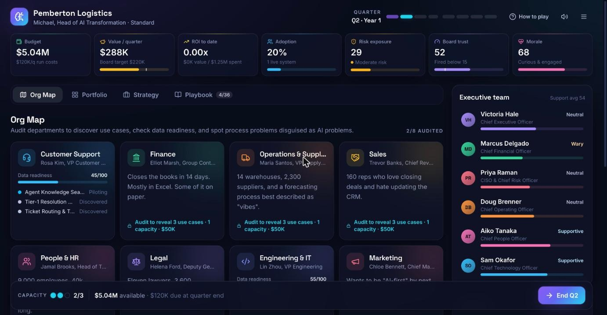
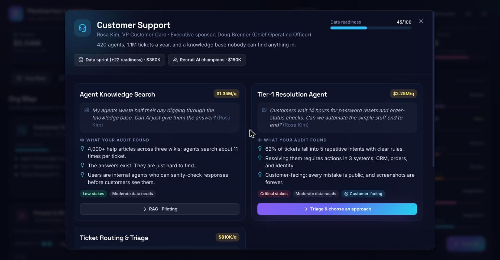
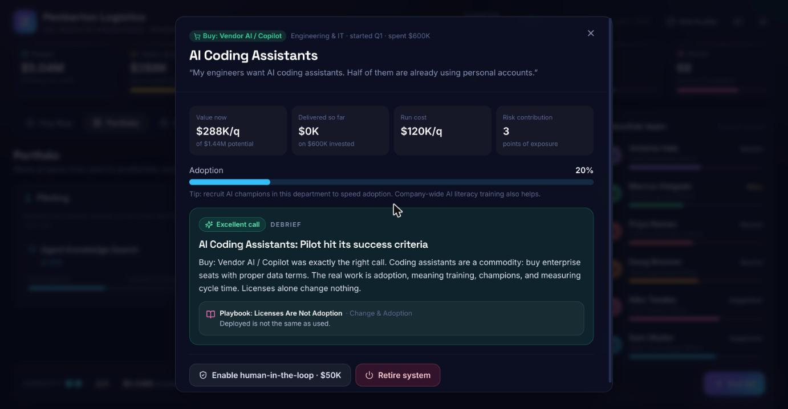
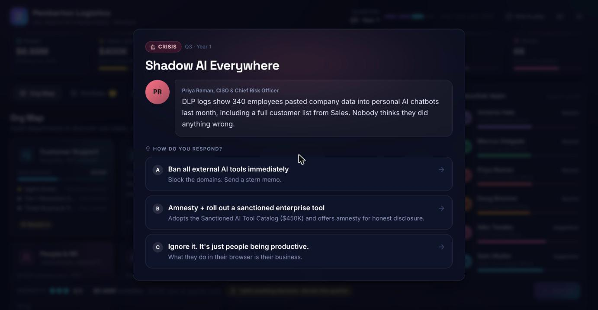
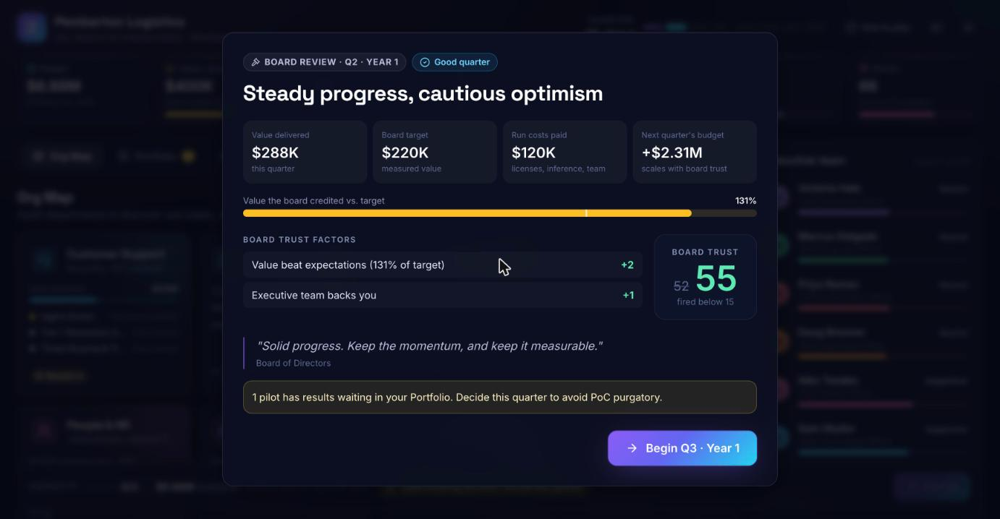
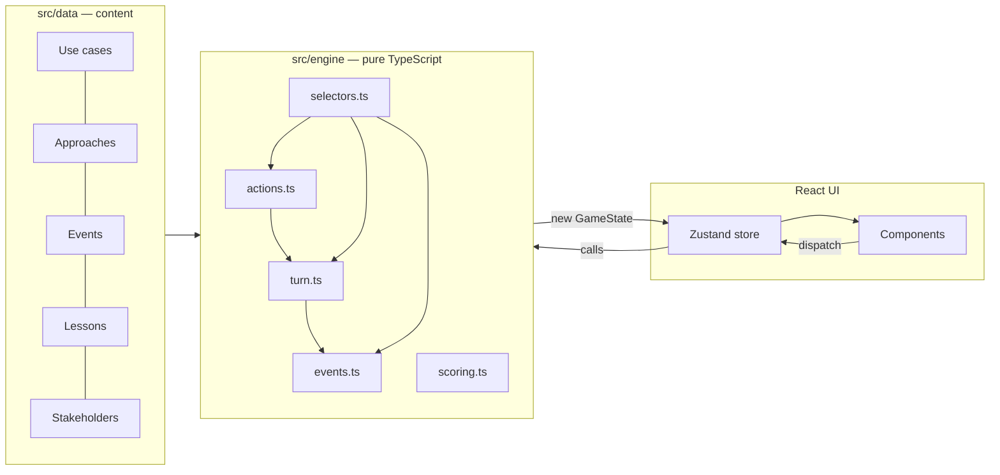

<div align="center">

# 🧠 AI Transformation Simulator

**You're the new Head of AI Transformation at a 90-year-old company.**
**Eight quarters. Six opinionated executives. One board that wants ROI. Don't get fired.**

A corporate strategy game that teaches how real enterprise AI transformation works: use-case triage, build vs. buy, governance, change management, and escaping PoC purgatory. Every decision ends with a debrief grounded in real-world cases.


### [▶ Play it live](https://makoydev.github.io/ai-transformation-simulator/)



</div>

---

## Why this exists

Most "AI strategy" content is slideware. This game makes you **feel the trade-offs** an AI Transformation Lead actually faces:

- The CEO wants agents in every department by Q4. The CFO wants a payback period. The CISO wants to know who approved that vendor.
- Half the "AI opportunities" you discover are really **broken processes**.
- Your best pilot is useless if nobody **adopts** it, and fatal if it **hallucinates a refund policy** to a customer.
- The board only credits value it can **measure**, and every flashy demo **raises the bar**.

## What you'll learn

| Pillar | In the game | The real-world lesson |
|---|---|---|
| 🔍 **Discovery & triage** | Audit 8 departments, read the clues, and spot process problems disguised as AI problems | *Don't automate the mess.* Fix the process first. |
| 🛠 **Build vs. buy** | Choose Process Redesign, Buy/Copilot, RAG, Agentic, Fine-tuning, or Predictive ML for 21 use cases | Match the tool to the shape of the problem: RAG for knowledge, ML for numbers, buy commodities |
| 🛡 **Governance & risk** | Six policies, a per-system human-in-the-loop setting, shadow AI, and risk-driven incidents | You own what your AI says. Agents need least privilege. |
| 🤝 **Change & adoption** | Morale, AI literacy, champions, town halls, and value that scales with adoption | Licenses ≠ adoption. Fear kills adoption. |
| 📈 **ROI & PoC purgatory** | Scale, iterate, or kill pilots; KPI dashboards; executive hype | Kill fast, measure everything, and remember that hype is debt |

## Gameplay

<table>
<tr>
<td width="50%"><br><b>Discovery.</b> Audits reveal use cases, clues, data readiness, and stakes.</td>
<td width="50%"><br><b>Debriefs.</b> Every pilot reveals why your approach did or didn't fit.</td>
</tr>
<tr>
<td width="50%"><br><b>Crises.</b> 23 events, from shadow AI and prompt injection to bias scandals and regulators.</td>
<td width="50%"><br><b>Board reviews.</b> A transparent breakdown of why trust moved each quarter.</td>
</tr>
</table>

**Each quarter:**

1. 🃏 **An event lands on your desk.** Pick a response and get a debrief, with a real-world parallel when there is one.
2. 🧭 **Spend team capacity:** audit departments, launch pilots, scale or kill results, adopt policies, train people, manage the board.
3. ⚙️ **End the quarter.** Pilots resolve, live systems deliver value at the rate people adopt them, run costs hit, and risk is rolled.
4. 🏛 **Face the board.** Fall below 15 trust and you're "transitioned to an advisory role."

After 8 quarters (or your firing), you get a **scorecard**: a grade from S to F, a **leadership archetype** (*The Transformation Architect*, *The PoC Collector*, *The Hype Merchant*, *The Cowboy Builder*, and more), badges, charts, and the **Playbook** principles you unlocked (36 in total).

### Features

- **3 companies × 3 difficulties:** a relaxed retailer, a standard logistics firm, and a brutally regulated insurer
- **21 use cases**, **6 approaches**, **23 events**, **6 stakeholders** with personalities, and **36 playbook principles**
- **Micro-animations everywhere:** spring-animated metrics with floating deltas, cards that move between Kanban columns, a dramatic pilot-results stamp, card-flip debriefs, screen shake on bad calls, confetti on production launches, and quarter title cards
- **Procedural sound effects** (Web Audio, no asset files) with a mute toggle
- **Auto-save:** close the tab and continue later
- **Accessible:** keyboard-navigable, respects `prefers-reduced-motion`, chart table views, and status shown with labels as well as color
- **Responsive:** playable on phones

## Tech stack

| Layer | Choice | Why |
|---|---|---|
| UI | **React 18 + TypeScript (strict)** | Component model fits a card-heavy game UI; types keep a large rules surface honest |
| Build | **Vite 7** | Instant dev server; static output deploys anywhere |
| State | **Zustand + Immer** | Tiny store with persistence; Immer keeps engine updates readable and immutable |
| Animation | **Framer Motion** | Layout animations, springs, presence transitions |
| Styling | **Tailwind CSS 4** | Design tokens in CSS (`@theme`), fast iteration |
| Juice | **canvas-confetti** + Web Audio | Celebrations without heavy assets |
| Tests | **Vitest** | Unit tests plus bot playthroughs that verify game balance |

## Architecture

The game rules live in a **pure, framework-free engine**. React never contains game logic: it renders state and dispatches actions.



- **Deterministic:** a seeded PRNG (mulberry32) lives *inside* the game state, so saves resume with identical future rolls and tests can replay games exactly.
- **Serializable:** `GameState` is plain JSON and persists to `localStorage` with versioned migrations.
- **Testable:** every rule is a pure `(state, action) → state` function.

```
src/
├── engine/          # Pure game rules: types, balance, actions, turn, events, scoring, selectors
│   ├── testing/     # Scripted bots used by balance tests
│   └── *.test.ts    # Unit + balance tests
├── data/            # Game content: use cases, approaches, events, lessons, stakeholders, scenarios
├── store/           # Zustand store: engine ↔ UI glue, toasts, modals, juice
├── components/
│   ├── hud/         # Top bar, metric tiles, action bar
│   ├── org/         # Org map, department modal, use cases, triage
│   ├── portfolio/   # Kanban board, project cards, results reveal
│   ├── strategy/    # Governance & change initiatives
│   ├── people/      # Stakeholders & inbox
│   ├── playbook/    # Lessons & decision log
│   ├── events/      # Event cards with debrief flip
│   ├── report/      # Quarterly board review
│   ├── feedback/    # Debriefs, toasts, transitions, how-to-play
│   ├── charts/      # Accessible SVG line chart
│   ├── screens/     # Title, setup, game, end
│   └── ui/          # Buttons, modals, meters, tooltips…
└── lib/             # Formatting, sound, confetti, icons
```

The full simulation model, including every formula, is documented in **[docs/GAME_DESIGN.md](docs/GAME_DESIGN.md)**.

## Getting started

Requires **Node 20.19+** (see `.nvmrc`).

```bash
npm install
npm run dev        # http://localhost:5173
```

| Script | Does |
|---|---|
| `npm run dev` | Start the dev server |
| `npm run build` | Typecheck and build to `dist/` |
| `npm run preview` | Serve the production build |
| `npm test` | Run unit tests and balance simulations |
| `npm run lint` | ESLint |
| `npm run typecheck` | TypeScript, no emit |

## Deployment

### GitHub Pages (included)

1. Push to a GitHub repo on the `main` branch.
2. Go to **Settings → Pages → Build and deployment → Source: GitHub Actions**.
3. The workflow in `.github/workflows/ci.yml` lints, typechecks, tests, builds, and deploys. It sets the correct base path for both project sites (`/<repo>/`) and user sites (`<name>.github.io`).

### Vercel / Netlify

Import the repo. The defaults work: build command `npm run build`, output directory `dist`.

## Extending the game

- **Add a use case:** append to `src/data/useCases.ts`, with clues that point to the ideal approach and a `why` debrief.
- **Add an event:** append to `src/data/events.ts`. Each choice's `resolve(draft)` mutates state and returns a debrief.
- **Rebalance:** tweak `src/engine/balance.ts`, then run `npm test` to see the bot results.

## A note on accuracy

Real-world references in debriefs are paraphrased from widely reported public cases and are listed in [docs/GAME_DESIGN.md](docs/GAME_DESIGN.md#10-real-world-references). Companies, vendors, and people inside the game are fictional. The simulation is a deliberately simplified teaching model, not a forecasting tool.

## License

[MIT](LICENSE)
